# sdd-engineering

A Spec-Driven Development (SDD) workflow for Claude Code. A feature moves from a
written **spec** to an approved **plan**, then to code that is **verified against
the plan** and **reviewed against your architecture**. Each stage is a separate
agent with a narrow job and narrow permissions. A person approves the spec and the
plan before any code is written.

```bash
/plugin install sdd-engineering@dev-digest-ai-marketplace
```

Installing it also installs its three dependencies from the same marketplace:
`engineering-paved-path`, `research-tools` and `architecture-review`.

## Updates

Auto-update is off for this marketplace until you turn it on: `/plugin` → **Marketplaces** → `dev-digest-ai-marketplace` → **Enable auto-update**. It does not run at startup. In an interactive session, after your first message, Claude Code waits a random delay of up to ten minutes, refreshes the marketplace and updates any plugin whose `plugin.json` version changed. It then shows `Plugin updated: sdd-engineering · Run /reload-plugins to apply`.

To update straight away instead, run this from your shell:

```bash
claude plugin marketplace update dev-digest-ai-marketplace
claude plugin update sdd-engineering@dev-digest-ai-marketplace
```

## How the pieces fit together

```mermaid
flowchart LR
  idea([Feature idea]) --> SC[spec-creator]
  SC -. spawns .-> R[research-tools:researcher]
  SC --> SPEC[/"&lt;specsDir&gt;/&lt;date&gt;-&lt;name&gt;.md<br/>Status: draft"/]
  SPEC --> H1{{You approve the spec}}
  H1 --> IP[implementation-planner]
  IP --> PLAN[/"&lt;plansDir&gt;/&lt;date&gt;-&lt;name&gt;-plan.md<br/>Status: draft"/]
  PLAN --> H2{{You approve the plan}}
  H2 --> RP["/run-plan"]
  subgraph run ["/run-plan loop"]
    RP --> IM[implementer ×N per wave]
    IM --> VG[verify gate]
    VG --> PV1[plan-verifier · steps]
    PV1 --> AR[architecture-review:architecture-reviewer]
    AR -- critical / major --> FX[implementer fix pass]
    FX --> AR
    AR -- clean --> PV2[plan-verifier · final]
  end
  PV2 --> H3{{You review the diff and commit}}
  PV2 -.-> EI[engineering-insights]
  H3 -.-> RETRO["/workflow-retro"]
```



1. **Spec.** `spec-creator` analyses your design sources (a description, Figma
   exports, existing code), interviews you about gaps and writes one
   `Status: draft` spec with EARS acceptance criteria, edge cases, NFRs and a
   traceability matrix. The spec header records the plugin version that wrote it
   (`Generated-by: sdd-engineering@<version>`). It can fan out `research-tools:researcher` agents to
   gather evidence.
2. **You approve the spec** by changing its `Status:` line to `approved`.
3. **Plan.** `implementation-planner` reviews the approved spec, asks about
   anything unclear, then writes one `Status: draft` Development Plan: steps in
   parallel **waves**, a **file-ownership** table, a **spec-coverage** matrix that
   maps every `MUST` criterion to a step, and the skill that governs each step.
4. **You approve the plan.**
5. **Run.** `/run-plan <plan>` runs the plan in your main session: parallel
   `implementer`s per wave, the verify gate, a `plan-verifier` completeness check,
   then an architecture-review loop that sends critical and major findings back
   through fix passes until the diff is clean or the round limit is hit.
6. **Learn.** Lessons go into `INSIGHTS.md` through `engineering-insights`, and
   `/workflow-retro` measures the run (tokens, agents, parallelism, tool errors)
   and suggests improvements.

## What it contains

| Component | Type | Use it when | Example |
|---|---|---|---|
| `spec-creator` | agent (opus) | a feature has no spec yet | `claude --agent sdd-engineering:spec-creator` then describe the feature |
| `implementation-planner` | agent (opus) | a spec is approved and needs a plan | "Use the implementation-planner to plan specs/2026-10-16-order-export.md" |
| `implementer` | agent (sonnet) | executing an approved plan, one wave, or a fix list | spawned by `/run-plan`; or "Use the implementer to do steps 1–2 of docs/plans/…-plan.md" |
| `plan-verifier` | agent (sonnet) | checking a change against its plan | "Use plan-verifier in final mode on docs/plans/…-plan.md" |
| `/run-plan` | skill (manual only) | running an approved plan end to end | `/run-plan docs/plans/2026-10-16-order-export-plan.md --verify "npm run check"` |
| `/workflow-retro` | skill (manual only) | after a multi-agent run | `/workflow-retro --save` |
| `engineering-insights` | skill | a task ends, or you hit a gotcha | loads by itself; or "update insights" |
| spec and plan guards | `PreToolUse` hooks | always on | see [Hooks](#hooks) |

`/run-plan` arguments:
`<plan-path> [--spec <path>] [--designs <path,…>] [--verify "<cmd>"] [--rounds N] [extra requirements…]`.

Run `spec-creator` as the main-thread agent (`claude --agent
sdd-engineering:spec-creator`) when you want it to spawn researchers; a subagent
cannot spawn subagents.

## Dependencies

| Plugin | Provides | Used by |
|---|---|---|
| `engineering-paved-path` | technical skills, all called by namespace: `engineering-paved-path:onion-architecture`, `:frontend-architecture`, `:mermaid-diagram`, `:security`, `:typescript-expert`, `:react-best-practices`, `:next-best-practices`, `:react-testing-library`, `:fastify-best-practices`, `:drizzle-orm-patterns`, `:postgresql-table-design`, `:zod`, and the `:skill-routing` table | planner (preloads the two architecture skills), implementer (loads skills through routing), spec-creator (Mermaid) |
| `research-tools` | `research-tools:researcher`, a read-only investigator | spec-creator, planner in multi-agent mode |
| `architecture-review` | `architecture-review:architecture-reviewer`, a read-only reviewer that reads your architecture docs first | `/run-plan` review loop |

No technical skill is copied into this plugin.

## Repo contract

The workflow reads one optional file by a fixed path: `.claude/sdd-engineering.json`.
Every key has a default. Besides it, agents read your `CLAUDE.md` / `AGENTS.md` as
normal project context and the files you or the plan point them at.

| Key | Default | Meaning |
|---|---|---|
| `specsDir` | `specs/` | where specs are written; the spec guard allows only this folder |
| `plansDir` | `docs/plans/` | where plans are written, as `*-plan.md`; the plan guard allows only this |
| `verifyCommand` | none | the mechanical check run after each wave and fix pass |
| `architectureDocs` | `ARCHITECTURE.md`, `docs/architecture/**` | passed to the architecture reviewer and read by the planner |
| `skillRouting` | `engineering-paved-path:skill-routing` | the file-to-skill routing table; point it at your own skill to override |
| `insights` | nearest `INSIGHTS.md` to the changed files, else `./INSIGHTS.md` | where lessons are written; a path or a list of paths |
| `retroLedger` | `docs/retros/ledger.md` | one row per `/workflow-retro` run |

```json
{
  "specsDir": "specs/",
  "plansDir": "docs/plans/",
  "verifyCommand": "npm run typecheck && npm test -- --changed",
  "architectureDocs": ["ARCHITECTURE.md", "docs/architecture/**"],
  "insights": ["apps/web/INSIGHTS.md", "services/api/INSIGHTS.md"]
}
```

The full reference is in
[`skills/run-plan/references/repo-contract.md`](skills/run-plan/references/repo-contract.md).

### Where files land

| File | Written by | Path |
|---|---|---|
| Spec | spec-creator | `<specsDir>/YYYY-MM-DD-<name>.md` |
| Development Plan | implementation-planner | `<plansDir>/YYYY-MM-DD-<name>-plan.md` |
| Code and trivial tests | implementer | files named in the plan's File ownership table |
| Lessons | engineering-insights | the `INSIGHTS.md` chosen by `insights` |
| Retro ledger / report | /workflow-retro | `retroLedger`; with `--save`, a report next to it |

### Spec and plan lifecycle

`draft` → `approved` → `implemented`. Agents only ever write `Status: draft`.
**Only a person promotes a spec or a plan.** An approved or implemented spec is
frozen; change it through a new spec with `Supersedes:`. The hooks enforce this.

### Without a verify command

`/run-plan` takes the command from `--verify`, then `verifyCommand`, then asks
you once. If you give none, the gate is recorded as `UNVERIFIED (no verify
command)`: implementers report it, `plan-verifier` marks every row that needed a
check as `CANNOT VERIFY`, and the final report lists it. No component guesses a
command such as `npm test`.

## Hooks

`hooks/hooks.json` registers two `PreToolUse` hooks on `Write|Edit`. They run
`node "${CLAUDE_PLUGIN_ROOT}/scripts/spec-guard.mjs"` and `plan-guard.mjs`, read
`.claude/sdd-engineering.json`, make no network calls and write nothing.

| Hook | Applies to | Blocks |
|---|---|---|
| `spec-guard.mjs` | `spec-creator` only | any file that is not a markdown file directly in `specsDir`; `*-plan.md`; edits to a spec whose `Status` is `approved` or `implemented`; any write that sets either status |
| `plan-guard.mjs` | `implementation-planner` only | any file that is not `<plansDir>/*-plan.md`; edits to a plan that is not `draft`; any write that sets a non-draft status |

The guards identify the agent from the `agent_type` field of the hook input and
exit immediately for every other agent and for your own edits. Plugin agents
ignore `hooks:` in their frontmatter, which is why the guards live in
`hooks/hooks.json`.

## Not in this plugin

The source workflow also had `test-writer`, `security-reviewer`, `orchestrator`,
`brainstorm` and `doc-writer`. They are not part of 1.0.0. Plan steps marked
`owner: tests` are reported by `/run-plan` as deferred, and there is no automated
security review: run one yourself before a PR.

## Requirements

- Claude Code 2.1.110 or later; see [COMPATIBILITY.md](COMPATIBILITY.md).
- Node.js on `PATH` for the hooks and the `/workflow-retro` collector.
- `git` for `/run-plan` and `plan-verifier`. `/run-plan` refuses to run on the
  default branch; create a feature branch first.
- No accounts, credentials or environment variables.

## Evals

Behavior evals live in [`evals/`](evals/README.md):

```bash
claude plugin eval plugins/sdd-engineering --scaffold --trust-plugin --allow-tools Write Edit Bash --ablation none
```
